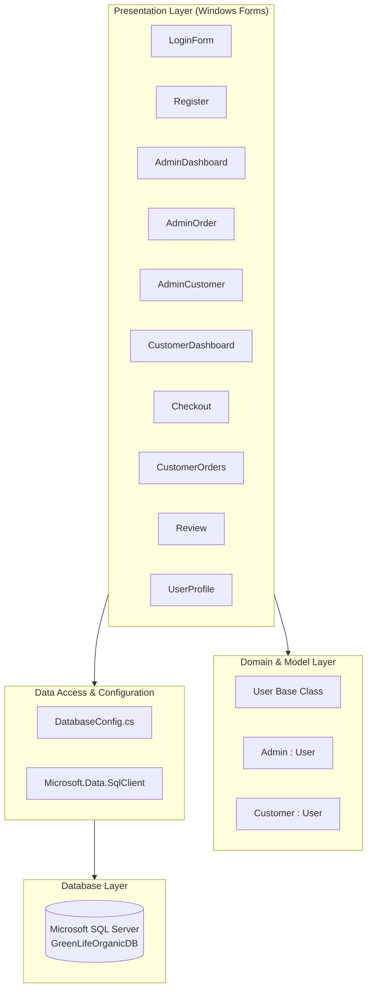
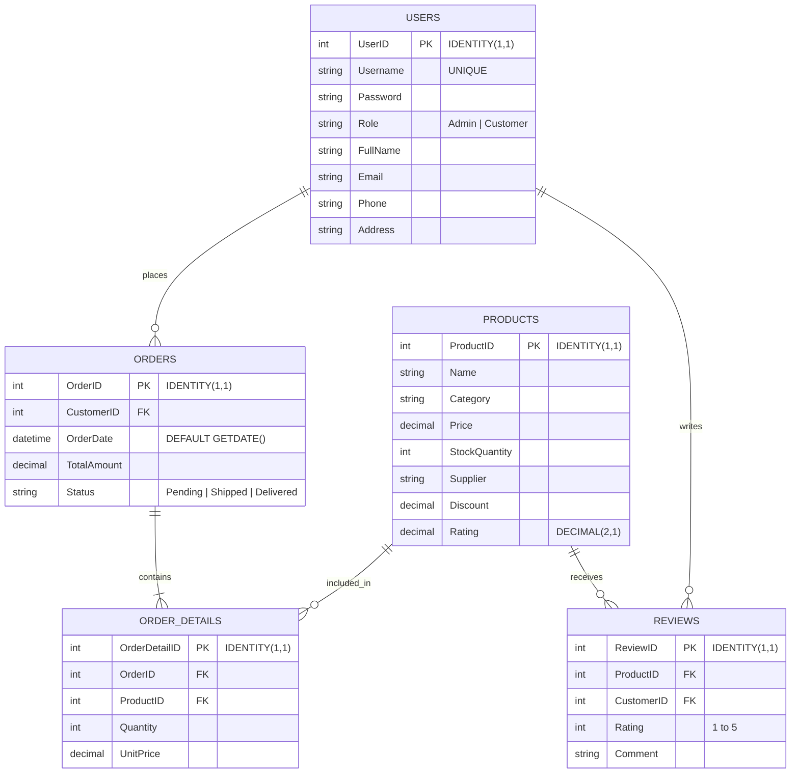

# 🌱 GreenLife Organic - Desktop Store Management System

[](https://dotnet.microsoft.com/)
[](https://learn.microsoft.com/en-us/dotnet/csharp/)
[](https://learn.microsoft.com/en-us/dotnet/desktop/winforms/)
[](https://www.microsoft.com/en-us/sql-server)
[](https://opensource.org/licenses/MIT)

**GreenLife Organic** is an enterprise-grade desktop store management and customer purchasing system built with **C#**, **.NET 8 (Windows Forms)**, and **Microsoft SQL Server**. It provides a role-based, end-to-end workflow connecting store administrators and retail customers with inventory control, real-time stock monitoring, promotional discount management, transactional checkout, customer reviews, and sales analytics.

---

## 📑 Table of Contents

- [Overview](#-overview)
- [System Architecture](#-system-architecture)
- [Key Features](#-key-features)
  - [🛡️ Administrator Portal](#️-administrator-portal)
  - [🛒 Customer Portal](#-customer-portal)
- [Database Design & Schema](#-database-design--schema)
  - [Entity Relationship Diagram](#entity-relationship-diagram)
  - [Database Schema & DDL Script](#database-schema--ddl-script)
- [Project Directory Structure](#-project-directory-structure)
- [Tech Stack & Dependencies](#-tech-stack--dependencies)
- [Prerequisites](#-prerequisites)
- [Installation & Getting Started](#-installation--getting-started)
  - [1. Clone or Download the Project](#1-clone-or-download-the-project)
  - [2. Configure Database](#2-configure-database)
  - [3. Configure Connection String](#3-configure-connection-string)
  - [4. Build and Run](#4-build-and-run)
- [User Roles & Default Workflow](#-user-roles--default-workflow)
- [Troubleshooting & FAQs](#-troubleshooting--faqs)
- [Future Enhancements](#-future-enhancements)
- [License](#-license)

---

## 🌿 Overview

The **GreenLife Organic Store Management System** is designed for organic retail businesses that require a reliable, high-performance desktop application for operational continuity. The system implements a clean separation of concerns, Object-Oriented Programming (OOP) hierarchy, and ACID-compliant transaction safety for inventory adjustments and financial processing.

### Highlights:
- **Role-Based Access Control (RBAC):** Dynamic navigation routing based on verified database roles (`Admin` and `Customer`).
- **ACID Transaction Safety:** Cart checkout and inventory decrements execute within atomic `SqlTransaction` scopes with automatic rollback on errors.
- **Automated Inventory Alerts:** Proactive threshold checks warn managers when items drop below minimum safety stock levels (< 5 units).
- **Reporting & CSV Export:** One-click CSV generation for both real-time inventory catalogues and order sales summaries.
- **Product Rating & Feedback Loop:** Verified star-rating calculation automatically aggregates average product ratings upon submission.

---

## 🏗️ System Architecture

The application adopts an **N-Tier Layered Architecture** leveraging ADO.NET and direct parameterized SQL queries to prevent SQL injection and ensure maximum data throughput.



---

## 🚀 Key Features

### 🛡️ Administrator Portal

| Module | Features & Capabilities |
| :--- | :--- |
| **Product Inventory Management** | Full CRUD operations (Create, Read, Update, Delete) for organic products. Manage Name, Category, Price, Stock Quantity, Supplier, and Discount percentage. |
| **Inventory Threshold Warnings** | Automated stock analysis executed on dashboard load. Alerts administrators with an itemized warning whenever product quantities fall below 5 units. |
| **Order Processing & Fulfillment** | View comprehensive order logs, filter by order date, inspect customer assignments, and update real-time status across **Pending**, **Shipped**, and **Delivered**. |
| **Line-Item Inspection** | Detailed breakdown modal showing each product, unit price, quantity purchased, and subtotal calculation per order. |
| **Customer Relationship Manager** | Directory of registered customers with real-time editing of customer full name, contact numbers, email addresses, and shipping destinations. |
| **Executive Sales Summary** | Aggregated financial report displaying total completed orders and cumulative revenue in USD ($). |
| **Data Export Engine** | Export current product inventory catalogs and historical sales orders into `.csv` files for spreadsheets and external accounting tools. |

---

### 🛒 Customer Portal

| Module | Features & Capabilities |
| :--- | :--- |
| **Account Registration & Login** | Self-service registration with automated username collision validation, customer profiling, and role assignment. |
| **Live Catalog Search & Sort** | Browse items in stock (`StockQuantity > 0`), filter dynamically by product name or category, and sort pricing (Ascending / Descending). |
| **Shopping Cart Engine** | Multi-item basket with real-time stock ceiling validation preventing overselling beyond available inventory. |
| **Promotional Discount Calculation** | Visual price breakdown computing percentage discounts and calculating final line item prices in real time. |
| **Transactional Checkout** | ACID-compliant order confirmation executing `INSERT Orders`, `INSERT OrderDetails`, and atomic `UPDATE Products (StockQuantity - qty)` inside a unified transaction. |
| **Order History & Tracking** | Historic ledger displaying all past purchases, timestamps, totals, and current delivery statuses. |
| **Feedback & Star Rating** | 1 to 5 star rating submission with customer reviews; recalculates and updates the global average rating on the target product. |
| **Profile & Security Manager** | Update personal phone number, delivery address, full name, and login password. |

---

## 🗄️ Database Design & Schema

### Entity Relationship Diagram



### Database Schema & DDL Script

If initializing on a fresh SQL Server instance without attaching the included `.mdf` file, run the following SQL script:

```sql
CREATE DATABASE GreenLifeOrganicDB;
GO

USE GreenLifeOrganicDB;
GO

-- 1. Users Table
CREATE TABLE Users (
    UserID INT IDENTITY(1,1) PRIMARY KEY,
    Username NVARCHAR(50) NOT NULL UNIQUE,
    Password NVARCHAR(255) NOT NULL,
    Role NVARCHAR(20) NOT NULL CHECK (Role IN ('Admin', 'Customer')),
    FullName NVARCHAR(100) NOT NULL,
    Email NVARCHAR(100) NULL,
    Phone NVARCHAR(20) NULL,
    Address NVARCHAR(255) NULL
);
GO

-- 2. Products Table
CREATE TABLE Products (
    ProductID INT IDENTITY(1,1) PRIMARY KEY,
    Name NVARCHAR(100) NOT NULL,
    Category NVARCHAR(50) NOT NULL,
    Price DECIMAL(10,2) NOT NULL,
    StockQuantity INT NOT NULL,
    Supplier NVARCHAR(100) NULL,
    Discount DECIMAL(5,2) DEFAULT 0.00,
    Rating DECIMAL(2,1) DEFAULT 0.0
);
GO

-- 3. Orders Table
CREATE TABLE Orders (
    OrderID INT IDENTITY(1,1) PRIMARY KEY,
    CustomerID INT NOT NULL FOREIGN KEY REFERENCES Users(UserID),
    OrderDate DATETIME DEFAULT GETDATE(),
    TotalAmount DECIMAL(10,2) NOT NULL,
    Status NVARCHAR(20) DEFAULT 'Pending' CHECK (Status IN ('Pending', 'Shipped', 'Delivered'))
);
GO

-- 4. Order Details Table
CREATE TABLE OrderDetails (
    OrderDetailID INT IDENTITY(1,1) PRIMARY KEY,
    OrderID INT NOT NULL FOREIGN KEY REFERENCES Orders(OrderID),
    ProductID INT NOT NULL FOREIGN KEY REFERENCES Products(ProductID),
    Quantity INT NOT NULL,
    UnitPrice DECIMAL(10,2) NOT NULL
);
GO

-- 5. Reviews Table
CREATE TABLE Reviews (
    ReviewID INT IDENTITY(1,1) PRIMARY KEY,
    ProductID INT NOT NULL FOREIGN KEY REFERENCES Products(ProductID),
    CustomerID INT NOT NULL FOREIGN KEY REFERENCES Users(UserID),
    Rating INT NOT NULL CHECK (Rating BETWEEN 1 AND 5),
    Comment NVARCHAR(MAX) NULL
);
GO

-- Seed Administrator Account
INSERT INTO Users (Username, Password, Role, FullName, Email, Phone, Address)
VALUES ('admin', 'admin123', 'Admin', 'Store Administrator', 'admin@greenlife.com', '0771234567', 'GreenLife HQ, Colombo');

-- Seed Sample Organic Products
INSERT INTO Products (Name, Category, Price, StockQuantity, Supplier, Discount, Rating)
VALUES 
('Organic Honey 500g', 'Pantry', 14.50, 25, 'BeePure Apiaries', 5.00, 4.8),
('Cold Pressed Olive Oil 1L', 'Oils', 22.00, 15, 'Mediterranean Grove', 10.00, 4.9),
('Fresh Organic Spinach 250g', 'Vegetables', 3.20, 4, 'Green Valley Organics', 0.00, 4.5),
('Almond Milk Unsweetened 1L', 'Dairy Alternatives', 4.80, 30, 'NutriHealth Farm', 0.00, 4.7),
('Raw Organic Chia Seeds 200g', 'Superfoods', 6.50, 3, 'NatureLife Imports', 15.00, 4.6);
GO
```

---

## 📁 Project Directory Structure

```text
GreenLife Organic/
│
├── GreenLifeOrganic/                       # Main .NET 8 WinForms Application Project
│   ├── Forms/                             # Application User Interface Forms
│   │   ├── LoginForm.cs                   # Authentication & role-based routing
│   │   ├── LoginForm.Designer.cs
│   │   ├── Register.cs                    # Customer account registration
│   │   ├── Register.Designer.cs
│   │   ├── AdminDashboard.cs              # Product CRUD, stock alert & analytics
│   │   ├── AdminDashboard.Designer.cs
│   │   ├── AdminCustomer.cs               # Admin customer account management
│   │   ├── AdminCustomer.Designer.cs
│   │   ├── AdminOrderForm.cs              # Admin order lifecycle & fulfillment
│   │   ├── AdminOrderForm.Designer.cs
│   │   ├── CustomerDashboard.cs           # Storefront catalog, search, and cart
│   │   ├── CustomerDashboard.Designer.cs
│   │   ├── Checkout.cs                    # Transactional basket checkout & discounts
│   │   ├── Checkout.Designer.cs
│   │   ├── CustomerOrders.cs              # Customer order history & itemized details
│   │   ├── CustomerOrders.Designer.cs
│   │   ├── Review.cs                      # Product star ratings & customer reviews
│   │   ├── Review.Designer.cs
│   │   ├── UserProfile.cs                 # Customer profile updates & password changes
│   │   └── UserProfile.Designer.cs
│   │
│   ├── Images/                            # UI Icons and Brand Media Assets
│   │   ├── GreenLife Organic Store.png
│   │   ├── Grocery.ico
│   │   └── logout.png
│   │
│   ├── Properties/
│   │   ├── Resources.resx                 # Embedded managed resources
│   │   └── Resources.Designer.cs
│   │
│   ├── DatabaseConfig.cs                  # SQL Server connection string & factory
│   ├── Program.cs                         # Application entrypoint (Main)
│   ├── User.cs                            # OOP models (User, Admin, Customer)
│   ├── GreenLifeOrganic.csproj            # Project file with dependencies
│   └── GreenLifeOrganic.sln               # Visual Studio Solution configuration
│
├── GreenLifeOrganicDB/                    # Pre-configured Local Database Files
│   ├── GreenLifeOrganicDB.mdf             # Primary Data File
│   └── GreenLifeOrganicDB_log.ldf         # Transaction Log File
│
└── README.md                              # Comprehensive project documentation
```

---

## 💻 Tech Stack & Dependencies

- **Language:** C# 12
- **Framework:** .NET 8.0 Windows Forms (`net8.0-windows`)
- **Database:** Microsoft SQL Server 2019 / 2022 / LocalDB
- **Database Driver:** `Microsoft.Data.SqlClient` (v6.1.4)
- **IDE:** Visual Studio 2022 (v17.0 or higher) / Visual Studio Code / .NET CLI

---

## 📋 Prerequisites

Before setting up the project, make sure the following dependencies are installed on your Windows environment:

1. **Operating System:** Windows 10 or Windows 11 (64-bit).
2. **.NET 8.0 SDK:** Download and install from [dotnet.microsoft.com](https://dotnet.microsoft.com/download/dotnet/8.0).
3. **Microsoft SQL Server:** Any edition (SQL Server Express, Developer, LocalDB, or Standard).
4. **Visual Studio 2022:** With the **".NET desktop development"** workload installed, or SQL Server Management Studio (SSMS).

---

## ⚙️ Installation & Getting Started

### 1. Clone or Download the Project

Clone this repository or extract the project folder to your local machine:
```bash
git clone https://github.com/your-username/GreenLife-Organic.git
cd "GreenLife Organic"
```

### 2. Configure Database

Choose **Option A** (Attach existing database files) or **Option B** (Execute DDL script):

#### Option A: Attach existing `.mdf` file
1. Open **SQL Server Management Studio (SSMS)** and connect to your SQL Server instance.
2. In the Object Explorer, right-click **Databases** ➔ Select **Attach...**.
3. Click **Add...** and navigate to:
   ```text
   ...\GreenLife Organic\GreenLifeOrganicDB\GreenLifeOrganicDB.mdf
   ```
4. Click **OK** to attach the database.

#### Option B: Run the SQL Creation Script
1. Open SSMS or your preferred SQL editor.
2. Open a new query window and run the complete SQL script provided in [Database Schema & DDL Script](#database-schema--ddl-script).

### 3. Configure Connection String

Open [`DatabaseConfig.cs`](file:///c:/Users/PASINDU/Desktop/GreenLife%20Organic/GreenLifeOrganic/DatabaseConfig.cs) located in `GreenLifeOrganic/DatabaseConfig.cs` and verify or update the connection string to match your local SQL Server instance:

```csharp
namespace GreenLifeOrganic
{
    public static class DatabaseConfig
    {
        // Replace 'DESKTOP-HBDVMFC' with your SQL instance name or '(localdb)\MSSQLLocalDB'
        public static string ConnectionString = 
            @"Data Source=YOUR_SERVER_NAME;Initial Catalog=GreenLifeOrganicDB;Integrated Security=True;TrustServerCertificate=True;";

        public static SqlConnection GetConnection()
        {
            return new SqlConnection(ConnectionString);
        }
    }
}
```

> [!TIP]
> If you are using **SQL Server Express**, your Data Source will typically be `.\SQLEXPRESS` or `localhost\SQLEXPRESS`. If using **LocalDB**, use `(localdb)\MSSQLLocalDB`.

### 4. Build and Run

#### Using Visual Studio:
1. Double-click [`GreenLifeOrganic.sln`](file:///c:/Users/PASINDU/Desktop/GreenLife%20Organic/GreenLifeOrganic/GreenLifeOrganic.sln) to open the solution in Visual Studio 2022.
2. Verify that **Debug | Any CPU** is selected.
3. Press **F5** or click the green **Start** button to build and launch the application.

#### Using .NET CLI:
Open PowerShell or Command Prompt in the project folder:
```powershell
cd "c:\Users\PASINDU\Desktop\GreenLife Organic\GreenLifeOrganic"
dotnet restore
dotnet build
dotnet run
```

---

## 👥 User Roles & Default Workflow

### 1. Store Administrator
- **Login Credentials:**
  - **Username:** `admin`
  - **Password:** `admin123`
- **Dashboard Features:**
  - View real-time product list and manage inventory items.
  - Review automated low stock popups (items with < 5 units in stock).
  - Check sales totals and order counts via the **Sales Report** link.
  - Export stock and orders to CSV.
  - Update order statuses (Pending ➔ Shipped ➔ Delivered) in **Manage Orders**.
  - Review and update customer profiles in **Manage Customers**.

### 2. Retail Customer
- **Login Credentials:**
  - Register a new account via the **Register** link on the login screen, or use existing customer credentials.
- **Shopping Workflow:**
  1. Log in to access the **Customer Dashboard**.
  2. Search for items or sort by price.
  3. Select an item, specify a quantity, and click **Add to Cart**.
  4. Click **View Cart** to review items, applied discounts, and grand totals.
  5. Click **Confirm Order** to place the order with transactional stock deduction.
  6. Review past order progress via **My Orders**.
  7. Leave feedback and star ratings on purchased items using the **Leave Review** modal.
  8. Update delivery details and passwords via the **My Profile** link.

---

## 🔧 Troubleshooting & FAQs

### Q1: "Cannot open database GreenLifeOrganicDB requested by the login"
- **Solution:** Verify that the database name in `DatabaseConfig.cs` matches the database in your SQL Server instance, and make sure your Windows account has permission to access the database.

### Q2: "A network-related or instance-specific error occurred while establishing a connection"
- **Solution:**
  1. Open Windows **Services** (`services.msc`) and ensure **SQL Server (MSSQLSERVER)** or **SQL Server (SQLEXPRESS)** is Running.
  2. In SQL Server Configuration Manager, ensure **TCP/IP** and **Named Pipes** are enabled under Network Configuration.

### Q3: "TrustServerCertificate=True Warning"
- **Solution:** `Microsoft.Data.SqlClient` version 6+ enables certificate encryption by default. `TrustServerCertificate=True` is already included in `DatabaseConfig.cs` to support local development environments with self-signed SSL certificates.

---

## 🔮 Future Enhancements

- [ ] **Modern UI Framework:** Migration to WPF or .NET MAUI for responsive design and native dark theme styling.
- [ ] **Secure Authentication:** Implementation of PBKDF2 / BCrypt password hashing and salting instead of plain text storage.
- [ ] **Payment Gateway Integration:** Integration with Stripe or PayPal SDK for direct digital payments.
- [ ] **Automated Receipt Generation:** Exporting printable PDF receipts and customer invoices with QR code verification.
- [ ] **Multi-store Supplier Logistics:** Purchase order generation and automated supplier restock notifications.

---

## 📄 License

This project is licensed under the [MIT License](https://opensource.org/licenses/MIT). You are free to use, modify, and distribute this software for academic and commercial purposes.

---

<p align="center">
  <b>Developed for GreenLife Organic Store Management System</b><br>
  Built with ❤️ using C# and .NET 8
</p>
